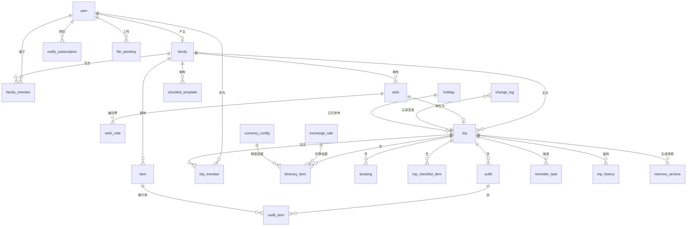

# 家庭出行计划 · 技术方案设计

| 项目       | 内容                                                               |
| ---------- | ------------------------------------------------------------------ |
| 文档名称   | 家庭出行计划 技术方案设计                                          |
| 版本       | **v1.2-RC1**（冻结候选 / Review Candidate）                        |
| 状态       | 内容已锁定 · **可即刻送审** · 复核意见闭环后转 FROZEN              |
| 修订日期   | 2026-09-30                                                         |
| 编制       | 磐石石（后端架构）                                                 |
| 关联文档   | 《PRD-家庭出行计划》v1.4、五份评审报告、项目决策台账 C1~C13        |
| 适用范围   | 微信小程序端（一期）+ Web 端（二期）共享后端                       |
| 技术选型   | **Taro + React + TS**（前端）/ **NestJS + TS**（后端）             |
| 配套交付物 | `TP-02A-DDL-变更脚本-v1.0.sql`、`TP-02B/C/D`、`TP-02-编码规范增补` |

## 修订记录（版本号唯一事实来源）

| 版本     | 日期           | 修订内容                                                                                                 | 编制       |
| -------- | -------------- | -------------------------------------------------------------------------------------------------------- | ---------- |
| v1.0     | 2026-09-24     | 初稿：技术选型、17 张表结构、接口清单、五大关键机制                                                      | —          |
| v1.1     | 2026-09-24     | 确认技术选型（Taro + NestJS）；并入测试评审补充项                                                        | —          |
| **v1.2** | **2026-09-30** | **合并产品组技术评审 + 第二评审意见 + 《待修改与待确认问题总清单》组 A~H 共 75 项；落库产品决策 C1~C13** | **磐石石** |
| v1.2-RC1 | 2026-10-08     | 引入文档状态机（RC / FROZEN 分离），解除「复核 ↔ 冻结」互相前置；内容未变                                | 磐石石     |

> **版本使用规则**：本表是全文档版本的唯一来源。正文、页眉、文件名一律标称 v1.2，不再出现其他版本号。

## 文档状态机（本稿 → 下游 的唯一通行规则）

**「冻结」被拆成两个独立事件，二者不再互为前提：**

| 状态              | 定义                                                       | 谁可宣告                           | 能做什么                             |
| ----------------- | ---------------------------------------------------------- | ---------------------------------- | ------------------------------------ |
| `DRAFT`           | 草稿，内容可改                                             | 编制人                             | 内部迭代                             |
| **`RC`** 冻结候选 | **内容已锁定、不再漂移**，版本号不可变                     | **编制人单方宣告，无需任何人批准** | **可送审**（提交复核）、可归档讨论   |
| `FROZEN` 正式冻结 | `RC` + **复核意见已闭环**（通过 / 有条件通过且条件项闭环） | 需复核方出意见                     | 可作为下游判定基准、可启动下游       |
| `REJECTED`        | 复核不通过                                                 | 复核方                             | 相关章节退回 `DRAFT` 重修，版本号 +1 |

**三条门禁（互为独立，不构成循环）：**

1. **送审门禁** = `RC` 即可。**不要求 `FROZEN`**。
2. **冻结门禁** = `RC` **且**《安全复核意见》闭环。**不要求「先冻结再送审」**。
3. **下游门禁** = `FROZEN` 才可启动 TP-05 测试包 / TP-06 运维包。**不依赖 `RC`**。

> 本轮关键澄清：复核的**输入是 `RC`，不是 `FROZEN`**。原表述「复核前不得冻结」被误读为「复核需先有一份冻结稿」，从而成环；正确读法是——`RC` 先锁版本送审，复核通过后才 FROZEN。

---

# 〇、本稿修订范围与口径

## 0.1 输入与覆盖

| 输入                        | 用途                                                 |
| --------------------------- | ---------------------------------------------------- |
| 技术评审报告（首轮）        | B 系列问题（表数量、加密格式、权限架构、同步延迟）   |
| 技术评审报告（产品组轮）    | B 系列 + T 系列（并发、时区、旁路泄漏、可测性）      |
| 技术评审报告 · 第二评审意见 | N 系列（软删唯一键、缓存、审计、媒体、精度、汇率源） |
| 待修改与待确认问题总清单    | 88 项分组的可执行清单（本稿闭环其中组 A~H 共 75 项） |
| 产品决策台账                | C1~C13 全部拍板结论                                  |

**覆盖结论**：组 A 26 + 组 B 6 + 组 C 7 + 组 D 8 + 组 E 8 + 组 F 5 + 组 G 6 + 组 H 9 = **75 项全部闭环**，逐项落点见附录 A。

## 0.2 表数量口径（原三处不一致的收敛结果）

| 口径来源     | 数值                          | 处置                                                |
| ------------ | ----------------------------- | --------------------------------------------------- |
| 原评审包声称 | 17                            | 作废                                                |
| 原正文建表   | 17                            | 经核对实为 17 张 `CREATE TABLE`，非清单记载的 14/15 |
| 原 ER 图覆盖 | 15                            | 缺 `holiday` / `exchange_rate` 未入图               |
| **本稿定稿** | **23 张**（16 现有 + 7 新增） | **唯一口径**（A24 签认合并后）                      |

**23 张 = 16 现有表 + 7 新增表**（`change_log`、`notify_subscription`、`currency_config`、`outfit_item`、`trip_history`、`memory_archive`、`file_pending`）。原 `trip_destination` 已按 A24 签认（2026-10-08）合并进 `trip.destinations_json`，不再单列；评审包、正文、ER 图、DDL 清单四处已按此对齐。

## 0.3 本稿涉及的两个编号治理动作

- **章节编号**：原评审包中「多端与同步」与「图片与媒体存储」被同时编为 8.3。本稿按现行正本编号体系统一为 **§4.3** 与 **§4.5**，全局唯一，并已核对无悬空交叉引用。
- **角色命名**：全文「出行参与者」统一改为 **「家庭内参与者」**，与 PRD / 设计侧口径一致（消除与「外部成员」的语义冲突）。

---

# 一、技术选型

## 1.1 总体技术栈

| 层             | 选型                                                    | 理由                                  |
| -------------- | ------------------------------------------------------- | ------------------------------------- |
| 小程序端       | ✅ **Taro + React + TypeScript**                        | 多端编译，二期 Web 复用业务代码与组件 |
| Web 端（二期） | **Vite + React + TypeScript**（或复用 Taro H5 产物）    | 与 Taro 同技术栈                      |
| 后端           | ✅ **NestJS + TypeScript**                              | 全栈 TypeScript；模块化架构清晰       |
| 数据库         | **MySQL 8.0+**（主库）+ **Redis**（缓存/会话/分布式锁） | 关系型结构清晰，事务可靠              |
| ORM            | **Prisma** 或 **TypeORM**                               | ⚠ 选型待定，见 §8.2 待验证 V3         |
| 对象存储       | **腾讯云 COS**                                          | 微信生态兼容，自带图片处理            |
| CDN            | **腾讯云 CDN**                                          | 与 COS 同厂商，回源链路短             |
| 消息推送       | **微信订阅消息**                                        | 唯一合规触达渠道                      |
| 定时任务       | **BullMQ（Redis）**                                     | NestJS 官方推荐，与 Redis 复用        |

## 1.2 系统架构

```
┌─────────────────┐        ┌─────────────────┐
│  Taro 小程序端   │        │  Taro H5 / Web  │
│  (React + TS)   │        │  (React + TS)   │
└────────┬────────┘        └────────┬────────┘
         │                          │
         └──────────┬───────────────┘
                    │ HTTPS / JSON
         ┌──────────▼───────────┐
         │  NestJS API Gateway  │
         │ (Guard 鉴权/限流/日志)│
         └──────────┬───────────┘
                    │
    ┌───────────────┼───────────────┐
    │               │               │
┌───▼────┐    ┌─────▼─────┐   ┌────▼────┐
│ 业务模块 │    │ BullMQ 队列│   │ 文件模块 │
│ (核心)  │    │(提醒/抓取) │   │ (签名)  │
└───┬────┘    └─────┬─────┘   └────┬────┘
    │               │              │
┌───▼────┐    ┌─────▼─────┐   ┌────▼────┐
│ MySQL  │    │   Redis   │   │   COS   │
│ (主数据)│    │(缓存/队列) │   │ + CDN   │
└────────┘    └───────────┘   └─────────┘
```

## 1.3 分层约定

| 层         | 职责                     | 注意                                                                                                                 |
| ---------- | ------------------------ | -------------------------------------------------------------------------------------------------------------------- |
| Controller | 参数校验、鉴权、响应封装 | **必须做权限校验**，不可依赖前端；方法须标注 `@RequireAccess` 或 `@Public()`（§4.7）                                 |
| Service    | 业务逻辑、事务边界       | 加密/解密、汇率折算在此层                                                                                            |
| Repository | 数据访问                 | **统一封装软删除（同时更新 `updated_at` 与 `deleted_token`）与时间戳**，业务代码禁止裸写 `UPDATE ... SET deleted_at` |
| Middleware | 鉴权、日志、异常、脱敏   | 鉴权解析出 `userId + familyId`；响应统一注入 `meta.updatedAt`                                                        |

---

# 二、数据库设计

## 2.1 设计原则

1. **软删除**：所有业务表带 `deleted_at`（`DATETIME(3)`），物理删除仅用于合规场景。
2. **时间戳**：所有表带 `created_at` / `updated_at`，用于多端同步判定。
3. **ID 策略**：主键用雪花 ID（`BIGINT`），避免自增暴露业务量，且分库友好。⚠ 现网主键有无符号差异，新增表须与现网核对后对齐（CHK-1）。
4. **权限公式落地**：`可见 ⟺ 属于自己的家庭 ∨ 属于自己参与的某次出行`，由 `trip_member` 统一承载；**私有资源走独立短路校验**（§4.7）。
5. **金额精度**：金额按币种 `minor_unit` 存储为整数最小单位（**`BIGINT`**），汇率 `DECIMAL(18,8)`；**禁止浮点与裸 `Number` 运算**（§4.2）。
6. **并发保护**：高频写入的共享态行带 `version` 乐观锁列（`trip`、`trip_checklist_item`）。

### 2.1.1 时间口径声明（强制）

| 类别                        | 类型          | 时区语义                         | 禁令                                              |
| --------------------------- | ------------- | -------------------------------- | ------------------------------------------------- |
| `*_at` / `*_time`（时刻列） | `DATETIME(3)` | **一律 UTC**                     | 禁止写本地时间                                    |
| `*_date`（自然日列）        | `DATE`        | **无时区自然日**                 | **禁止任何 `toUTC()` 换算**；禁止参与时区偏移运算 |
| 服务端时间                  | —             | 统一取 DB `CURRENT_TIMESTAMP(3)` | 禁止用应用服务器 `new Date()` 写库                |

- **时区唯一作用域是提醒**：`reminder_task.remind_at`（`DATETIME(3)` UTC）+ `reminder_task.tz`（`VARCHAR(64)` IANA，生成时快照用户常驻地时区）。
- `trip.start_date` / `end_date` / `itinerary_item.item_date` / `outfit.outfit_date` / `holiday.date` / `exchange_rate.rate_date` / `memory_archive.year` 均属自然日语义，跨时区展示时按用户本地日历直接取原值。
- 约束：全文检索 `toUTC` 仅应出现在「禁止」语境。
- **存量精度扩容（2026-10-08 签认，选 B · 分两批执行）**：新建表与现有表的新增列一律直接 `DATETIME(3)`（已含于 DDL v1.0）；存量 `DATETIME`（无小数秒）列的扩容**不随本次 DDL**，二期单独排维护窗口、以在线表变更工具（如 `pt-online-schema-change`）执行。此动作不改变存量值语义（毫秒位补 `.000`），风险仅在表重建的物理过程（锁表 / 双倍空间）。

## 2.2 核心表结构

> 以下为 **v1.2 定稿结构**（现有表已并入 75 项整改结果）。DDL 可执行脚本见 `TP-02A-DDL-变更脚本-v1.0.sql`。

### 2.2.1 用户与家庭

```sql
CREATE TABLE `user` (
  `id`            BIGINT       NOT NULL COMMENT '雪花ID',
  `openid`        VARCHAR(64)  DEFAULT NULL COMMENT '微信 openid（小程序）',
  `unionid`       VARCHAR(64)  DEFAULT NULL COMMENT '微信 unionid（多端打通）',
  `phone`         VARCHAR(20)  DEFAULT NULL COMMENT '手机号（Web端备用登录）',
  `home_timezone` VARCHAR(64)  NOT NULL DEFAULT 'Asia/Shanghai' COMMENT '用户常驻地时区（IANA）；提醒时区快照来源',
  `nickname`      VARCHAR(64)  NOT NULL DEFAULT '',
  `avatar`        VARCHAR(512) NOT NULL DEFAULT '',
  `base_currency` VARCHAR(8)   NOT NULL DEFAULT 'CNY' COMMENT '基准币种',
  `created_at`    DATETIME(3)  NOT NULL DEFAULT CURRENT_TIMESTAMP(3),
  `updated_at`    DATETIME(3)  NOT NULL DEFAULT CURRENT_TIMESTAMP(3) ON UPDATE CURRENT_TIMESTAMP(3),
  `deleted_at`    DATETIME(3)  DEFAULT NULL,
  `deleted_token` CHAR(36)     NOT NULL DEFAULT '' COMMENT '软删令牌：活跃恒空串，软删写 UUID（唯一键软删化）',
  PRIMARY KEY (`id`),
  UNIQUE KEY `uk_openid`  (`openid`,  `deleted_token`),
  UNIQUE KEY `uk_unionid` (`unionid`, `deleted_token`),
  UNIQUE KEY `uk_phone`   (`phone`)          -- MySQL 唯一索引对 NULL 放行多行，满足"允许不填"
) COMMENT='用户';

CREATE TABLE `family` (
  `id`            BIGINT      NOT NULL,
  `name`          VARCHAR(64) NOT NULL DEFAULT '我的家',
  `owner_id`      BIGINT      NOT NULL COMMENT '户主用户ID',
  `invite_code`   VARCHAR(16) NOT NULL COMMENT '邀请码；长期有效、无次数上限，户主可重置（重置即作废旧码，N-S6）',
  `created_at`    DATETIME(3) NOT NULL DEFAULT CURRENT_TIMESTAMP(3),
  `updated_at`    DATETIME(3) NOT NULL DEFAULT CURRENT_TIMESTAMP(3) ON UPDATE CURRENT_TIMESTAMP(3),
  `deleted_at`    DATETIME(3) DEFAULT NULL,
  `deleted_token` CHAR(36)    NOT NULL DEFAULT '',
  PRIMARY KEY (`id`),
  UNIQUE KEY `uk_invite_code` (`invite_code`, `deleted_token`)
) COMMENT='家庭';

CREATE TABLE `family_member` (
  `id`           BIGINT       NOT NULL,
  `family_id`    BIGINT       NOT NULL,
  `user_id`      BIGINT       DEFAULT NULL COMMENT '真实用户ID；虚拟成员为 NULL',
  `is_virtual`   TINYINT(1)   NOT NULL DEFAULT 0,
  `display_name` VARCHAR(64)  NOT NULL,
  `avatar`       VARCHAR(512) NOT NULL DEFAULT '',
  `role`         VARCHAR(16)  NOT NULL DEFAULT 'MEMBER' COMMENT 'OWNER/MEMBER',
  `managed_by`   BIGINT       DEFAULT NULL COMMENT '虚拟成员的代管人用户ID（权限链必需）',
  `joined_at`    DATETIME(3)  NOT NULL DEFAULT CURRENT_TIMESTAMP(3),
  `deleted_at`   DATETIME(3)  DEFAULT NULL,
  PRIMARY KEY (`id`),
  UNIQUE KEY `uk_family_user`   (`family_id`, `user_id`),
  KEY `idx_family`              (`family_id`),
  KEY `idx_user`                (`user_id`),
  KEY `idx_user_alive`          (`user_id`,   `deleted_at`),
  KEY `idx_family_alive`        (`family_id`, `deleted_at`),
  CONSTRAINT `chk_fm_virtual` CHECK (`is_virtual` = 0 OR `managed_by` IS NOT NULL)
) COMMENT='家庭成员（含虚拟成员）';
```

### 2.2.2 心愿池

```sql
CREATE TABLE `wish` (
  `id`             BIGINT       NOT NULL,
  `family_id`      BIGINT       NOT NULL,
  `destination`    VARCHAR(128) NOT NULL,
  `reason`         VARCHAR(255) DEFAULT NULL,
  `tags`           JSON         DEFAULT NULL,
  `budget_min`     BIGINT       DEFAULT NULL COMMENT '基准币最小单位整数',
  `budget_max`     BIGINT       DEFAULT NULL,
  `budget_currency` VARCHAR(8)  DEFAULT 'CNY',
  `best_duration`  INT          DEFAULT NULL,
  `best_season`    VARCHAR(64)  DEFAULT NULL,
  `climate_note`   VARCHAR(255) DEFAULT NULL,
  `images`         JSON         DEFAULT NULL,
  `links`          JSON         DEFAULT NULL,
  `vote_count`     INT          NOT NULL DEFAULT 0 COMMENT '票数(冗余)',
  `vote_count_synced_at` DATETIME(3) DEFAULT NULL COMMENT 'vote_count 最近一次对账时刻 UTC(3)',
  `status`         VARCHAR(16)  NOT NULL DEFAULT 'WANT' COMMENT 'WANT/PLANNED/DONE/DROPPED',
  `converted_trip_id` BIGINT    DEFAULT NULL,
  `created_at`     DATETIME(3)  NOT NULL DEFAULT CURRENT_TIMESTAMP(3),
  `updated_at`     DATETIME(3)  NOT NULL DEFAULT CURRENT_TIMESTAMP(3) ON UPDATE CURRENT_TIMESTAMP(3),
  `deleted_at`     DATETIME(3)  DEFAULT NULL,
  PRIMARY KEY (`id`),
  KEY `idx_family_status` (`family_id`, `status`)
) COMMENT='心愿池';

-- 投票记录（不记名展示，但需记录防重复）
CREATE TABLE `wish_vote` (
  `id`            BIGINT      NOT NULL,
  `wish_id`       BIGINT      NOT NULL,
  `user_id`       BIGINT      NOT NULL,
  `created_at`    DATETIME(3) NOT NULL DEFAULT CURRENT_TIMESTAMP(3),
  `updated_at`    DATETIME(3) NOT NULL DEFAULT CURRENT_TIMESTAMP(3) ON UPDATE CURRENT_TIMESTAMP(3),
  `deleted_at`    DATETIME(3) DEFAULT NULL COMMENT '取消投票=软删；再次投票=原行复活',
  `deleted_token` CHAR(36)    NOT NULL DEFAULT '',
  PRIMARY KEY (`id`),
  UNIQUE KEY `uk_wish_user` (`wish_id`, `user_id`, `deleted_token`)
) COMMENT='心愿投票记录';
-- 评估结论（2026-10-08 已签认）：取消投票采用软删；再次投票 = deleted_at / deleted_token 置空「原行复活」，
-- 与全局统一软删约定（§2.5 / E4 Repository 封装）一致，不为本表开硬删特例。
```

### 2.2.3 出行核心

```sql
CREATE TABLE `trip` (
  `id`             BIGINT       NOT NULL,
  `family_id`      BIGINT       NOT NULL COMMENT '主办家庭',
  `year`           INT          NOT NULL COMMENT '归属年份（跨年取结束日期所在年，自然日无时区）',
  `title`          VARCHAR(128) NOT NULL DEFAULT '',
  `start_date`     DATE         NOT NULL,
  `end_date`       DATE         NOT NULL,
  `status`         VARCHAR(16)  NOT NULL DEFAULT 'PLANNING' COMMENT 'PLANNING/FIXED/DONE/CANCELLED',
  `base_currency`  VARCHAR(8)   NOT NULL DEFAULT 'CNY',
  `budget_json`    JSON         DEFAULT NULL COMMENT '分类预算（写入前须过 schema 校验）',
  `actual_json`    JSON         DEFAULT NULL COMMENT '分类实际（冗余汇总；更新走事务+行锁）',
  `destinations_json` JSON      DEFAULT NULL COMMENT '目的地清单（数组；替代 trip_destination 表，写入前过 schema 校验）',
  `source_wish_id` BIGINT       DEFAULT NULL,
  `created_by`     BIGINT       NOT NULL,
  `created_at`     DATETIME(3)  NOT NULL DEFAULT CURRENT_TIMESTAMP(3),
  `updated_at`     DATETIME(3)  NOT NULL DEFAULT CURRENT_TIMESTAMP(3) ON UPDATE CURRENT_TIMESTAMP(3),
  `version`        BIGINT UNSIGNED NOT NULL DEFAULT 1 COMMENT '乐观锁：保护 actual_json 与并发热点行',
  `deleted_at`     DATETIME(3)  DEFAULT NULL,
  PRIMARY KEY (`id`),
  KEY `idx_family_year` (`family_id`, `year`),
  KEY `idx_dates`       (`start_date`, `end_date`),
  KEY `idx_updated`     (`updated_at`)
) COMMENT='出行';

-- 【A24 已签认（2026-10-08）：trip_destination 合并进 trip.destinations_json】
-- 原独立表从定稿结构中取消，目的地由 trip 表的 destinations_json 列承载，
-- 不再计入定稿表数量（24 → 23 张）。
-- 迁移三步（可回滚）：
--   ① trip 加 destinations_json → 程序回填存量；
--   ② 代码切读新列（灰度观察）；
--   ③ 原 trip_destination 转只读 → 二期删表。
-- 过渡期物理表保留（仅供迁移），非定稿结构的一部分。

CREATE TABLE `trip_member` (
  `id`            BIGINT      NOT NULL,
  `trip_id`       BIGINT      NOT NULL,
  `user_id`       BIGINT      DEFAULT NULL COMMENT '用户ID；虚拟成员为 NULL',
  `member_ref`    BIGINT      DEFAULT NULL COMMENT '引用 family_member.id（虚拟成员用）',
  `managed_by`    BIGINT      DEFAULT NULL COMMENT '虚拟成员代管人 user_id（修复权限链断点）',
  `is_leader`     TINYINT(1)  NOT NULL DEFAULT 0 COMMENT '是否主导者',
  `is_external`   TINYINT(1)  NOT NULL DEFAULT 0 COMMENT '是否外部成员（非主办家庭成员）',
  `access_level`  ENUM('ACTIVE','HISTORICAL_READONLY') NOT NULL DEFAULT 'ACTIVE' COMMENT '历史只读访问级别',
  `joined_at`     DATETIME(3) NOT NULL DEFAULT CURRENT_TIMESTAMP(3),
  `left_at`       DATETIME(3) DEFAULT NULL COMMENT '退出/移除时刻',
  `deleted_at`    DATETIME(3) DEFAULT NULL,
  PRIMARY KEY (`id`),
  UNIQUE KEY `uk_trip_user`     (`trip_id`, `user_id`),
  KEY `idx_trip`                (`trip_id`),
  KEY `idx_user`                (`user_id`),
  KEY `idx_trip_external`       (`trip_id`, `external_user_id`),
  KEY `idx_managed_by`          (`managed_by`)
) COMMENT='出行成员（含外部成员）';
```

> **权限判定总纲（详见 §4.7）**
> 访问资源 R：**先判私有域** —— 若 R 属私有资源（私有清单 / 个人物品库 / 个人穿搭），只认 `owner_id = U OR managed_by = U`，**短路返回，不参与家庭 / 出行的 OR 合并**；否则按「家庭 ∨ 出行」两维度合并判定。
> 成员退出后其私有内容 `owner_id` **保持不变，不软删、不转移**。

### 2.2.4 行程与预订

```sql
CREATE TABLE `itinerary_item` (
  `id`            BIGINT        NOT NULL,
  `trip_id`       BIGINT        NOT NULL,
  `item_date`     DATE          NOT NULL COMMENT '所属日期（无时区自然日）',
  `time_slot`     VARCHAR(8)    NOT NULL COMMENT 'MORNING/NOON/AFTERNOON/EVENING',
  `title`         VARCHAR(128)  NOT NULL,
  `note`          TEXT          DEFAULT NULL,
  `images`        JSON          DEFAULT NULL,
  `need_booking`  TINYINT(1)    NOT NULL DEFAULT 0,
  `booking_remind_days` INT     DEFAULT NULL,
  `booking_date`  DATE          DEFAULT NULL,
  `amount`        BIGINT        DEFAULT NULL COMMENT '原始币种最小单位整数',
  `currency`      VARCHAR(8)    DEFAULT 'CNY',
  `exchange_rate` DECIMAL(18,8) DEFAULT NULL COMMENT '快照汇率：1 单位 base_currency 折合多少 quote_currency',
  `rate_time`     DATETIME(3)   DEFAULT NULL COMMENT '汇率取数时刻',
  `rate_source`   ENUM('AUTO','MANUAL') NOT NULL DEFAULT 'AUTO' COMMENT '汇率来源',
  `rate_by`       BIGINT        DEFAULT NULL COMMENT '手动覆盖操作人；MANUAL 时必填',
  `amount_base`   BIGINT        DEFAULT NULL COMMENT '基准币最小单位整数；NULL = 汇率待补（不计入任何汇总）',
  `category`      VARCHAR(16)   DEFAULT 'OTHER' COMMENT 'TRANSPORT/HOTEL/FOOD/TICKET/SHOPPING/OTHER',
  `sort`          INT           NOT NULL DEFAULT 0,
  `created_at`    DATETIME(3)   NOT NULL DEFAULT CURRENT_TIMESTAMP(3),
  `updated_at`    DATETIME(3)   NOT NULL DEFAULT CURRENT_TIMESTAMP(3) ON UPDATE CURRENT_TIMESTAMP(3),
  `deleted_at`    DATETIME(3)   DEFAULT NULL,
  PRIMARY KEY (`id`),
  KEY `idx_trip_date` (`trip_id`, `item_date`),
  KEY `idx_updated`   (`updated_at`),
  CONSTRAINT `chk_ii_rate_by` CHECK (`rate_source` = 'AUTO' OR `rate_by` IS NOT NULL)
) COMMENT='行程事项';

CREATE TABLE `booking` (
  `id`              BIGINT        NOT NULL,
  `trip_id`         BIGINT        NOT NULL,
  `type`            VARCHAR(16)   NOT NULL COMMENT 'TRANSPORT/HOTEL',
  `detail_json`     JSON          DEFAULT NULL COMMENT '非敏感明细（写入前须过 schema 校验）',
  `order_no_enc`    VARBINARY(512)  DEFAULT NULL COMMENT '★ 订单号密文',
  `order_link_enc`  VARBINARY(2048) DEFAULT NULL COMMENT '★ 订单链接密文（容量提升，禁止静默截断）',
  `amount`          BIGINT        DEFAULT NULL,
  `currency`        VARCHAR(8)    DEFAULT 'CNY',
  `exchange_rate`   DECIMAL(18,8) DEFAULT NULL,
  `rate_source`     ENUM('AUTO','MANUAL') NOT NULL DEFAULT 'AUTO',
  `rate_by`         BIGINT        DEFAULT NULL,
  `amount_base`     BIGINT        DEFAULT NULL COMMENT 'NULL = 汇率待补（不计入任何汇总）',
  `created_by`      BIGINT        NOT NULL,
  `created_at`      DATETIME(3)   NOT NULL DEFAULT CURRENT_TIMESTAMP(3),
  `updated_at`      DATETIME(3)   NOT NULL DEFAULT CURRENT_TIMESTAMP(3) ON UPDATE CURRENT_TIMESTAMP(3),
  `deleted_at`      DATETIME(3)   DEFAULT NULL,
  PRIMARY KEY (`id`),
  KEY `idx_trip`       (`trip_id`),
  KEY `idx_created_by` (`created_by`),
  CONSTRAINT `chk_bk_rate_by` CHECK (`rate_source` = 'AUTO' OR `rate_by` IS NOT NULL)
) COMMENT='预订信息（敏感字段加密）';
-- 评估结论（2026-10-08 已签认）：一期不拆分 booking_transport / booking_hotel，
-- 改为把高频查询字段提升为真实列（列全集待 CHK-13 核对现表 info_json 结构后确定）。
```

### 2.2.5 清单与穿搭

```sql
CREATE TABLE `checklist_template` (
  `id`         BIGINT      NOT NULL,
  `family_id`  BIGINT      NOT NULL,
  `owner_id`   BIGINT      DEFAULT NULL COMMENT 'NULL=全家共用模板；有值=私人模板',
  `name`       VARCHAR(64) NOT NULL,
  `category`   VARCHAR(16) NOT NULL DEFAULT 'OTHER' COMMENT 'ID/ELECTRONIC/WASH/MEDICINE/OTHER',
  `sort`       INT         NOT NULL DEFAULT 0,
  `created_at` DATETIME(3) NOT NULL DEFAULT CURRENT_TIMESTAMP(3),
  `updated_at` DATETIME(3) NOT NULL DEFAULT CURRENT_TIMESTAMP(3) ON UPDATE CURRENT_TIMESTAMP(3),
  `deleted_at` DATETIME(3) DEFAULT NULL,
  PRIMARY KEY (`id`),
  KEY `idx_family_owner` (`family_id`, `owner_id`)
) COMMENT='清单模板（共用/私人）';

CREATE TABLE `trip_checklist_item` (
  `id`                 BIGINT      NOT NULL,
  `trip_id`            BIGINT      NOT NULL,
  `owner_id`           BIGINT      DEFAULT NULL COMMENT 'NULL=本次共用清单；有值=某人私人清单',
  `name`               VARCHAR(64) NOT NULL,
  `category`           VARCHAR(16) NOT NULL DEFAULT 'OTHER',
  `is_checked`         TINYINT(1)  NOT NULL DEFAULT 0,
  `scope`              ENUM('SHARED','PERSONAL') NOT NULL DEFAULT 'SHARED' COMMENT '显式域标记，替代以 owner_id 是否为空隐式表达',
  `version`            BIGINT UNSIGNED NOT NULL DEFAULT 1 COMMENT '乐观锁：勾选走 CAS',
  `source_family_id`   BIGINT      DEFAULT NULL,
  `source_template_id` BIGINT      DEFAULT NULL,
  `checked_by`         BIGINT      DEFAULT NULL,
  `checked_at`         DATETIME(3) DEFAULT NULL,
  `created_at`         DATETIME(3) NOT NULL DEFAULT CURRENT_TIMESTAMP(3),
  `updated_at`         DATETIME(3) NOT NULL DEFAULT CURRENT_TIMESTAMP(3) ON UPDATE CURRENT_TIMESTAMP(3),
  `deleted_at`         DATETIME(3) DEFAULT NULL,
  PRIMARY KEY (`id`),
  KEY `idx_trip_owner` (`trip_id`, `owner_id`),
  KEY `idx_updated`    (`updated_at`),
  CONSTRAINT `chk_tci_scope_owner` CHECK (
    (`scope` = 'SHARED'   AND `owner_id` IS NULL) OR
    (`scope` = 'PERSONAL' AND `owner_id` IS NOT NULL)
  )
) COMMENT='出行清单实例';

CREATE TABLE `item` (
  `id`         BIGINT       NOT NULL,
  `owner_id`   BIGINT       NOT NULL COMMENT '物品归属人（真实或虚拟成员）',
  `family_id`  BIGINT       NOT NULL,
  `name`       VARCHAR(64)  NOT NULL,
  `category`   VARCHAR(16)  NOT NULL DEFAULT 'OTHER',
  `image`      VARCHAR(512) DEFAULT NULL,
  `created_at` DATETIME(3)  NOT NULL DEFAULT CURRENT_TIMESTAMP(3),
  `updated_at` DATETIME(3)  NOT NULL DEFAULT CURRENT_TIMESTAMP(3) ON UPDATE CURRENT_TIMESTAMP(3),
  `deleted_at` DATETIME(3)  DEFAULT NULL,
  PRIMARY KEY (`id`),
  KEY `idx_owner` (`owner_id`)
) COMMENT='个人物品库';

CREATE TABLE `outfit` (
  `id`          BIGINT      NOT NULL,
  `owner_id`    BIGINT      NOT NULL,
  `trip_id`     BIGINT      DEFAULT NULL COMMENT 'NULL=模板；有值=某次出行的穿搭',
  `outfit_date` DATE        DEFAULT NULL COMMENT '安排日期（无时区自然日）',
  `time_slot`   VARCHAR(8)  DEFAULT NULL,
  `name`        VARCHAR(64) DEFAULT NULL,
  `item_ids`    JSON        DEFAULT NULL COMMENT '【一期保留，二期删列】迁移期兼容，新写入一律走 outfit_item',
  `is_template` TINYINT(1)  NOT NULL DEFAULT 0,
  `created_at`  DATETIME(3) NOT NULL DEFAULT CURRENT_TIMESTAMP(3),
  `updated_at`  DATETIME(3) NOT NULL DEFAULT CURRENT_TIMESTAMP(3) ON UPDATE CURRENT_TIMESTAMP(3),
  `deleted_at`  DATETIME(3) DEFAULT NULL,
  PRIMARY KEY (`id`),
  KEY `idx_owner_trip` (`owner_id`, `trip_id`)
) COMMENT='穿搭（模板或出行实例）';

-- 【新增】穿搭-物品关联，替代 outfit.item_ids JSON
CREATE TABLE `outfit_item` (
  `id`         BIGINT UNSIGNED NOT NULL AUTO_INCREMENT,
  `outfit_id`  BIGINT UNSIGNED NOT NULL,
  `item_id`    BIGINT UNSIGNED NOT NULL,
  `sort_order` SMALLINT UNSIGNED NOT NULL DEFAULT 0,
  `created_at` DATETIME(3)     NOT NULL DEFAULT CURRENT_TIMESTAMP(3),
  `updated_at` DATETIME(3)     NOT NULL DEFAULT CURRENT_TIMESTAMP(3) ON UPDATE CURRENT_TIMESTAMP(3),
  PRIMARY KEY (`id`),
  UNIQUE KEY `uk_outfit_item` (`outfit_id`, `item_id`),
  KEY `idx_item` (`item_id`)
) COMMENT='穿搭-物品关联表（支撑按物品反查穿搭）';
```

### 2.2.6 系统辅助表

```sql
CREATE TABLE `holiday` (
  `id`         BIGINT      NOT NULL,
  `year`       INT         NOT NULL,
  `date`       DATE        NOT NULL COMMENT '无时区自然日',
  `type`       VARCHAR(16) NOT NULL COMMENT 'HOLIDAY/WORKDAY(调休上班)',
  `name`       VARCHAR(32) DEFAULT NULL,
  `source`     VARCHAR(32) DEFAULT NULL,
  `created_at` DATETIME(3) NOT NULL DEFAULT CURRENT_TIMESTAMP(3),
  `updated_at` DATETIME(3) NOT NULL DEFAULT CURRENT_TIMESTAMP(3) ON UPDATE CURRENT_TIMESTAMP(3),
  PRIMARY KEY (`id`),
  UNIQUE KEY `uk_date` (`date`),
  KEY `idx_year` (`year`)
) COMMENT='法定节假日';

CREATE TABLE `exchange_rate` (
  `id`             BIGINT        NOT NULL,
  `base_currency`  VARCHAR(8)    NOT NULL COMMENT '源币种',
  `quote_currency` VARCHAR(8)    NOT NULL COMMENT '目标币种',
  `rate`           DECIMAL(18,8) NOT NULL COMMENT '1 单位 base_currency 折合多少 quote_currency',
  `rate_date`      DATE          NOT NULL COMMENT '汇率日期（无时区自然日）',
  `source`         VARCHAR(32)   DEFAULT NULL COMMENT '取数档位：合规授权源（中间价）',
  `created_at`     DATETIME(3)   NOT NULL DEFAULT CURRENT_TIMESTAMP(3),
  `updated_at`     DATETIME(3)   NOT NULL DEFAULT CURRENT_TIMESTAMP(3) ON UPDATE CURRENT_TIMESTAMP(3),
  PRIMARY KEY (`id`),
  UNIQUE KEY `uk_pair_date` (`base_currency`, `quote_currency`, `rate_date`)
) COMMENT='汇率（按日，合规授权源·中间价）';

CREATE TABLE `currency_config` (
  `currency_code` CHAR(3)         NOT NULL COMMENT 'ISO 4217 货币代码',
  `minor_unit`    TINYINT UNSIGNED NOT NULL COMMENT '最小货币单位小数位：JPY=0 / CNY=2 / BHD=3',
  `rounding_mode` VARCHAR(16)     NOT NULL DEFAULT 'ROUND_HALF_UP',
  `is_active`     TINYINT(1)      NOT NULL DEFAULT 1,
  `created_at`    DATETIME(3)     NOT NULL DEFAULT CURRENT_TIMESTAMP(3),
  `updated_at`    DATETIME(3)     NOT NULL DEFAULT CURRENT_TIMESTAMP(3) ON UPDATE CURRENT_TIMESTAMP(3),
  PRIMARY KEY (`currency_code`)
) COMMENT='币种精度与舍入规则（前后端共用唯一事实来源）';

CREATE TABLE `reminder_task` (
  `id`               BIGINT      NOT NULL,
  `trip_id`          BIGINT      NOT NULL,
  `target_type`      VARCHAR(16) NOT NULL COMMENT 'BOOKING_ITEM/COMMON_ITEM',
  `target_id`        BIGINT      DEFAULT NULL,
  `remind_type`      VARCHAR(24) NOT NULL COMMENT 'BOOKING_D2/BOOKING_D0/TRIP_D0/ITEM_D3/TRIP_D1',
  `remind_at`        DATETIME(3) NOT NULL COMMENT '计划发送时刻 UTC(3)',
  `tz`               VARCHAR(64) NOT NULL DEFAULT 'Asia/Shanghai' COMMENT '生成时快照的用户常驻地时区（IANA）',
  `receiver_id`      BIGINT      NOT NULL COMMENT '接收人（主导者）',
  `channel`          ENUM('SUBSCRIBE','IN_APP_TODO') NOT NULL DEFAULT 'IN_APP_TODO' COMMENT '实际投递渠道',
  `delivery`         ENUM('SUBSCRIBE_FIRST','TODO_ONLY') NOT NULL DEFAULT 'SUBSCRIBE_FIRST' COMMENT '投递策略；TODO_ONLY 即应用内待办',
  `merged_group_id`  BIGINT UNSIGNED DEFAULT NULL COMMENT '同刻多条合并组 ID',
  `status`           VARCHAR(16) NOT NULL DEFAULT 'PENDING' COMMENT 'PENDING/SENT/FAILED/CANCELLED',
  `sent_at`          DATETIME(3) DEFAULT NULL,
  `read_at`          DATETIME(3) DEFAULT NULL COMMENT '待办已读时刻',
  `created_at`       DATETIME(3) NOT NULL DEFAULT CURRENT_TIMESTAMP(3),
  `updated_at`       DATETIME(3) NOT NULL DEFAULT CURRENT_TIMESTAMP(3) ON UPDATE CURRENT_TIMESTAMP(3),
  `deleted_at`       DATETIME(3) DEFAULT NULL,
  PRIMARY KEY (`id`),
  KEY `idx_remind_at`         (`status`, `remind_at`),
  KEY `idx_receiver_delivery` (`receiver_id`, `delivery`)
) COMMENT='提醒任务（同时是应用内待办数据源，不另建 todo 表）';

-- 【新增】多端同步游标唯一来源（一期启用）
CREATE TABLE `change_log` (
  `id`          BIGINT UNSIGNED NOT NULL AUTO_INCREMENT,
  `changed_at`  DATETIME(3)     NOT NULL COMMENT '变更时刻 UTC(3)，同步游标第一维',
  `entity_type` VARCHAR(64)     NOT NULL,
  `entity_id`   BIGINT UNSIGNED NOT NULL,
  `op`          ENUM('INSERT','UPDATE','DELETE') NOT NULL,
  `actor_id`    BIGINT UNSIGNED DEFAULT NULL,
  `trace_id`    VARCHAR(64)     DEFAULT NULL,
  PRIMARY KEY (`id`),
  KEY `idx_cursor` (`changed_at`, `id`),
  KEY `idx_entity` (`entity_type`, `entity_id`, `id`)
) COMMENT='多端同步变更日志（游标 (changed_at, id) 复合，严格开区间；保留期由 TP-06 定）';

-- 【新增】微信订阅消息授权台账
CREATE TABLE `notify_subscription` (
  `id`           BIGINT UNSIGNED NOT NULL AUTO_INCREMENT,
  `user_id`      BIGINT UNSIGNED NOT NULL,
  `template_id`  VARCHAR(64)     NOT NULL,
  `sub_type`     ENUM('ONCE','LONG_TERM') NOT NULL DEFAULT 'ONCE' COMMENT '长期订阅优先，类目未过审则回落一次性',
  `status`       ENUM('ACCEPTED','REJECTED','BANNED') NOT NULL DEFAULT 'ACCEPTED',
  `remain_count` INT UNSIGNED    NOT NULL DEFAULT 0 COMMENT '剩余可下发次数（LONG_TERM 恒 0 = 不限次）',
  `expire_at`    DATETIME(3)     DEFAULT NULL,
  `granted_at`   DATETIME(3)     DEFAULT NULL,
  `last_used_at` DATETIME(3)     DEFAULT NULL,
  `created_at`   DATETIME(3)     NOT NULL DEFAULT CURRENT_TIMESTAMP(3),
  `updated_at`   DATETIME(3)     NOT NULL DEFAULT CURRENT_TIMESTAMP(3) ON UPDATE CURRENT_TIMESTAMP(3),
  PRIMARY KEY (`id`),
  UNIQUE KEY `uk_user_template` (`user_id`, `template_id`),
  KEY `idx_user_status` (`user_id`, `status`)
) COMMENT='订阅消息授权台账（降级链路数据源）';

-- 【新增】trip 变更前快照，每 trip 仅保留最近 1 个历史版本
CREATE TABLE `trip_history` (
  `id`            BIGINT UNSIGNED NOT NULL AUTO_INCREMENT,
  `trip_id`       BIGINT UNSIGNED NOT NULL,
  `version`       BIGINT UNSIGNED NOT NULL COMMENT '快照对应的 trip.version',
  `snapshot_json` JSON            NOT NULL COMMENT '覆盖前的完整 trip 快照（含 actual_json）',
  `edited_by`     BIGINT UNSIGNED DEFAULT NULL,
  `created_at`    DATETIME(3)     NOT NULL DEFAULT CURRENT_TIMESTAMP(3),
  PRIMARY KEY (`id`),
  KEY `idx_trip_version` (`trip_id`, `version`)
) COMMENT='trip 变更前快照（兑现"保留最近 1 个历史版本"承诺）';

-- 【新增】回忆区只读快照：归档内容不随原始数据修订而漂移
CREATE TABLE `memory_archive` (
  `id`            BIGINT UNSIGNED NOT NULL AUTO_INCREMENT,
  `memory_id`     BIGINT UNSIGNED NOT NULL,
  `type`          ENUM('TRIP','ANNUAL') NOT NULL COMMENT 'TRIP=出行结束即固化 / ANNUAL=年度总结',
  `trip_id`       BIGINT UNSIGNED DEFAULT NULL,
  `year`          SMALLINT UNSIGNED DEFAULT NULL COMMENT 'type=ANNUAL 时的自然年度（无时区）',
  `snapshot_json` JSON            NOT NULL,
  `photo_keys`    JSON            DEFAULT NULL COMMENT '快照引用的照片 COS 键（对象不进归档层，仅引用）',
  `checksum`      CHAR(64)        DEFAULT NULL COMMENT '快照 SHA-256，防漂移校验',
  `archived_at`   DATETIME(3)     NOT NULL DEFAULT CURRENT_TIMESTAMP(3),
  `created_at`    DATETIME(3)     NOT NULL DEFAULT CURRENT_TIMESTAMP(3),
  `updated_at`    DATETIME(3)     NOT NULL DEFAULT CURRENT_TIMESTAMP(3) ON UPDATE CURRENT_TIMESTAMP(3),
  PRIMARY KEY (`id`),
  UNIQUE KEY `uk_memory_type` (`memory_id`, `type`),
  KEY `idx_year_type` (`year`, `type`),
  KEY `idx_trip` (`trip_id`)
) COMMENT='回忆区只读快照（无任何写接口对外暴露）';

-- 【新增】上传文件先待确认台账（孤儿文件治理）
CREATE TABLE `file_pending` (
  `id`            BIGINT UNSIGNED NOT NULL AUTO_INCREMENT,
  `file_key`      VARCHAR(512)    NOT NULL COMMENT 'COS 对象键（含 u/{userId}/t/{tripId}/ 前缀）',
  `purpose`       VARCHAR(32)     NOT NULL,
  `expected_size` BIGINT UNSIGNED NOT NULL COMMENT '签名时申报字节数',
  `content_type`  VARCHAR(64)     DEFAULT NULL COMMENT '白名单内类型',
  `status`        ENUM('PENDING','CONFIRMED','ORPHANED') NOT NULL DEFAULT 'PENDING',
  `confirmed_at`  DATETIME(3)     DEFAULT NULL,
  `created_at`    DATETIME(3)     NOT NULL DEFAULT CURRENT_TIMESTAMP(3),
  `updated_at`    DATETIME(3)     NOT NULL DEFAULT CURRENT_TIMESTAMP(3) ON UPDATE CURRENT_TIMESTAMP(3),
  PRIMARY KEY (`id`),
  UNIQUE KEY `uk_file_key` (`file_key`),
  KEY `idx_status_created` (`status`, `created_at`)
) COMMENT='上传文件先待确认台账（先待确认后标记有效，防误删有效文件）';
```

## 2.3 ER 关系总览

> 本次已补齐此前缺失的 `holiday` / `exchange_rate` / `reminder_task` 及全部 7 张新增表。



```
user ─┬─< family_member >─ family
      │                        │
      │                        ├─< wish ─< wish_vote
      │                        ├─< checklist_template
      │                        └─< item ─< outfit_item >─ outfit
      │
      └─< trip_member >─ trip ─┬─< itinerary_item      （金额精度 ← currency_config / exchange_rate；目的地内联于 trip.destinations_json）
                               ├─< booking
                               ├─< trip_checklist_item
                               ├─< outfit
                               ├─< reminder_task
                               ├─< trip_history
                               └─< memory_archive

user ─< notify_subscription      user ─< file_pending
change_log（跨实体，记录所有实体变更）      holiday（日历辅助，无外键）
```

## 2.4 表清单与数量口径

| #    | 表                                                                                                                                                                                                      | 状态             |
| ---- | ------------------------------------------------------------------------------------------------------------------------------------------------------------------------------------------------------- | ---------------- |
| 1~16 | `user` `family` `family_member` `wish` `wish_vote` `trip` `trip_member` `itinerary_item` `booking` `checklist_template` `trip_checklist_item` `item` `outfit` `holiday` `exchange_rate` `reminder_task` | 现有（已整改）   |
| 17   | `change_log`                                                                                                                                                                                            | 新增（一期启用） |
| 18   | `notify_subscription`                                                                                                                                                                                   | 新增             |
| 19   | `currency_config`                                                                                                                                                                                       | 新增             |
| 20   | `outfit_item`                                                                                                                                                                                           | 新增             |
| 21   | `trip_history`                                                                                                                                                                                          | 新增             |
| 22   | `memory_archive`                                                                                                                                                                                        | 新增             |
| 23   | `file_pending`                                                                                                                                                                                          | 新增             |

**合计 23 张**。原 `trip_destination` 已按 A24 签认（2026-10-08）合并进 `trip.destinations_json`，不再单列。

## 2.5 软删与唯一键约定（强制）

| 约定                                   | 内容                                                                                                                                              |
| -------------------------------------- | ------------------------------------------------------------------------------------------------------------------------------------------------- |
| 软删语义                               | `deleted_at`：`NULL` = 活跃，非 `NULL` = 已删                                                                                                     |
| 唯一键软删化                           | 需要「软删后可重建 + 活跃行唯一」的表，唯一键一律并入 `deleted_token CHAR(36) NOT NULL DEFAULT ''`：活跃行恒为空串，软删时由 Repository 写入 UUID |
| 为什么不用复合 `(biz_key, deleted_at)` | MySQL 中 `NULL` 互不相等，两个活跃行（`deleted_at` 均为 `NULL`）不会触发唯一冲突，会放进重复数据——这正是原方案要堵的洞                            |
| 统一封装                               | 软删操作在一个事务内同时更新 `deleted_at` / `updated_at` / `deleted_token`；**业务代码禁止裸写 `SET deleted_at`**，CI 强制拦截                    |
| 复活语义                               | 「再次投票 / 重新入团」= `deleted_at := NULL`、`deleted_token := ''`，走独立封装的复活方法                                                        |

---

# 三、接口设计

## 3.1 接口规范

| 项               | 约定                                                                                            |
| ---------------- | ----------------------------------------------------------------------------------------------- |
| 协议             | HTTPS + JSON                                                                                    |
| 鉴权             | Header `Authorization: Bearer <token>`                                                          |
| 响应结构         | `{ code: 0, message: 'ok', data: {...}, meta: {...} }`                                          |
| **写响应时间戳** | **所有写接口响应 `meta.updatedAt` + `meta.serverTime`，取自 DB 时间**（客户端据此判断同步状态） |
| 分页             | `page` / `pageSize`，返回 `total`；增量同步用 `cursor`                                          |
| 时间格式         | 时刻列 ISO 8601 带 `Z`（UTC）；自然日列 `YYYY-MM-DD`（无时区）                                  |
| 错误码           | 4xxxx 客户端错误，5xxxx 服务端错误                                                              |
| **越权响应**     | 越权与资源不存在返回**逐字节一致**的 404（§4.7）                                                |

## 3.2 接口清单

### 3.2.1 账号与家庭

| 方法       | 路径                            | 说明                                                                           |
| ---------- | ------------------------------- | ------------------------------------------------------------------------------ |
| POST       | `/auth/login`                   | 微信登录（code 换 token）                                                      |
| GET / PUT  | `/user/profile`                 | 获取 / 更新个人资料（含 `home_timezone`）                                      |
| POST       | `/family`                       | 创建家庭                                                                       |
| GET        | `/family/current`               | 获取当前家庭信息                                                               |
| POST       | `/family/join`                  | 通过邀请码加入家庭                                                             |
| GET        | `/family/invite-code`           | 获取邀请码/邀请链接                                                            |
| POST       | `/family/invite-code/reset`     | **重置邀请码（户主）**——生成新码、旧码立即作废；N-S6「长期有效」口径的兜底能力 |
| DELETE     | `/family/member/{id}`           | 移除成员（户主）                                                               |
| POST / PUT | `/family/member/virtual[/{id}]` | 创建 / 编辑虚拟成员（须带 `managed_by`）                                       |
| POST       | `/family/transfer-owner`        | 转让户主（**并发保护**：`UPDATE ... WHERE id=? AND owner_id=?` 乐观锁）        |
| DELETE     | `/family`                       | 解散家庭                                                                       |

### 3.2.2 心愿池

| 方法 | 路径                   | 说明                                    |
| ---- | ---------------------- | --------------------------------------- |
| GET  | `/wishes`              | 心愿列表（排序 votes/created）          |
| POST | `/wishes`              | 添加心愿                                |
| PUT  | `/wishes/{id}`         | 编辑心愿                                |
| POST | `/wishes/{id}/vote`    | 投票 / 取消投票（取消=软删，再投=复活） |
| PUT  | `/wishes/{id}/status`  | 变更状态                                |
| POST | `/wishes/{id}/to-trip` | 一键带入，生成出行草稿                  |

### 3.2.3 年度规划与出行

| 方法               | 路径                                            | 说明                                                        |
| ------------------ | ----------------------------------------------- | ----------------------------------------------------------- |
| GET                | `/trips?year=2026`                              | 按年份查询出行                                              |
| POST               | `/trips`                                        | 创建出行                                                    |
| GET / PUT / DELETE | `/trips/{id}`                                   | 详情 / 编辑（**须带 `version`**，冲突返 409）/ 软删         |
| GET                | `/trips/conflict-check`                         | 冲突校验（提示不阻断）                                      |
| POST               | `/trips/{id}/members`                           | 添加参与成员（含外部成员）                                  |
| DELETE             | `/trips/{id}/members/{memberId}`                | 移除参与成员                                                |
| **PUT**            | **`/trips/{tripId}/members/{memberId}/access`** | **★ 设置历史只读访问级别 `ACTIVE` / `HISTORICAL_READONLY`** |
| PUT                | `/trips/{id}/leaders`                           | 设置主导者列表（**行锁保护，禁止主导者数归零**）            |
| GET                | `/holidays?year=2026`                           | 获取节假日数据                                              |
| **GET**            | **`/sync/changes?cursor=&scope=`**              | **★ 服务端游标增量同步（`scope=recent\|all`）**             |

### 3.2.4 行程与预订

| 方法         | 路径                    | 说明                                          |
| ------------ | ----------------------- | --------------------------------------------- |
| GET / POST   | `/trips/{id}/itinerary` | 行程列表（按天分组）/ 添加事项                |
| PUT / DELETE | `/itinerary/{itemId}`   | 编辑 / 删除事项（金额变更须带 `rate_source`） |
| POST         | `/trips/{id}/bookings`  | 添加预订                                      |
| GET / PUT    | `/bookings/{id}`        | 查看（按权限返回明文/**整字段脱敏**）/ 编辑   |

### 3.2.5 清单与穿搭

| 方法       | 路径                         | 说明                                                      |
| ---------- | ---------------------------- | --------------------------------------------------------- |
| GET        | `/trips/{id}/checklist`      | 出行清单（共用 + 私人，**按域过滤 + 聚合占位**，见 §4.7） |
| PUT        | `/checklist-item/{id}/check` | 勾选 / 取消勾选（**CAS：须带 `version`，冲突返 409**）    |
| POST       | `/trips/{id}/checklist/sync` | 模板同步到出行（预览 + 确认两段式）                       |
| GET / POST | `/checklist-templates`       | 获取 / 新增模板项                                         |
| GET / POST | `/items`                     | 物品库（按人过滤）/ 新增物品                              |
| GET / POST | `/outfits`                   | 穿搭列表（模板 / 某次出行）/ 创建穿搭                     |
| POST       | `/outfits/{id}/apply`        | 套用穿搭模板到指定日期                                    |

### 3.2.6 统计、汇率与文件

| 方法    | 路径                                 | 说明                                                                       |
| ------- | ------------------------------------ | -------------------------------------------------------------------------- |
| GET     | `/trips/{id}/cost-summary`           | 预算 vs 实际分类对比（`SUM(amount_base)`）                                 |
| GET     | `/exchange-rate?from=JPY&to=CNY`     | 获取汇率（含快照时间与取数档位披露）                                       |
| **GET** | **`/currency-config`**               | **★ 币种精度规则（前后端共用唯一事实来源）**                               |
| **GET** | **`/todo`**                          | **★ 应用内待办（读 `reminder_task` 中 `delivery='TODO_ONLY'`，不另建表）** |
| POST    | `/upload/sign`                       | 获取 COS 直传签名（**受限：purpose + contentType + size**）                |
| GET     | `/memories?year=2026`                | 回忆归档列表                                                               |
| GET     | `/memories/{year}/summary`           | 年度回忆总结                                                               |
| **GET** | **`/memories/archives?year=&type=`** | **★ 回忆只读快照查询（`type=TRIP\|ANNUAL`）**                              |

---

# 四、关键机制实现

## 4.1 字段级加密与密钥生命周期

### 4.1.1 方案

| 项       | 方案                                                    |
| -------- | ------------------------------------------------------- |
| 算法     | **AES-256-GCM**（带认证，防篡改）                       |
| 密钥管理 | 服务端 **KMS** 托管，按环境隔离（dev/staging/prod）     |
| 密钥轮换 | 多版本密钥（`key_ver`），新数据用新密钥，旧版本保留可解 |
| 加密范围 | `booking.order_no`、`booking.order_link` 等敏感字段     |
| IV       | 每条记录独立随机 IV，与密文一起存储                     |

### 4.1.2 存储格式

```
[1B format_ver][1B key_ver][1B algo_id][12B IV][ciphertext][16B tag]
```

| 字段         | 长度 | 说明                                |
| ------------ | ---- | ----------------------------------- |
| `format_ver` | 1B   | 存储布局版本，当前 `0x01`           |
| `key_ver`    | 1B   | 密钥版本，轮换递增                  |
| `algo_id`    | 1B   | 算法标识，当前 `0x01` = AES-256-GCM |
| `IV`         | 12B  | `crypto.randomBytes(12)`            |
| `tag`        | 16B  | GCM 认证标签                        |

### 4.1.3 实现强制项

| #   | 规则                                                                                                                                                             |
| --- | ---------------------------------------------------------------------------------------------------------------------------------------------------------------- |
| 1   | **AAD 绑定**：`setAAD(format_ver ‖ key_ver ‖ algo_id ‖ recordId)`。绑定后密文无法被平移/替换到另一条记录；解密必须传完全相同的 AAD                               |
| 2   | **解密前长度校验**：`field_length >= 1+1+1+12+0+16`，不足立即抛错，**禁止静默截断**                                                                              |
| 3   | **IV 规范**：只允许 `crypto.randomBytes(12)`；**禁止**时间戳 / 计数器 / `Math.random()` / 从 `recordId` 派生；同一记录重加密**必须换新 IV**。CI 静态检查 IV 来源 |
| 4   | **落库容量**：`order_link_enc VARBINARY(2048)`，容量不足即报错，不可静默截断                                                                                     |
| 5   | **DEK 缓存**：启动从 KMS 拉取并本地缓存，**TTL ≤ 10 分钟**，轮换事件主动刷新；生产**禁用 heapdump**；密钥不进日志                                                |
| 6   | **密钥退役三步**：① 转只读（停止用该版本加密）→ ② 观察该 `key_ver` 密文数量归零 → ③ 销毁。**未归零绝不销毁**                                                     |
| 7   | **调用量监控**：同密钥累计加密调用数上限 **2³²**，达 90% 预警即轮换                                                                                              |

### 4.1.4 解密权限与脱敏

```
可见明文 ⟺ 用户是 booking.created_by ∨ 用户是 trip 的主导者（is_leader = 1）
否则整字段脱敏
```

| 字段     | 脱敏展示                                                               |
| -------- | ---------------------------------------------------------------------- |
| 订单号   | `****1234`（保留后 4 位）                                              |
| 订单链接 | **不返回整字段**，提示"仅可见人可查看"（不做部分掩码，避免长度侧信道） |

## 4.2 汇率快照与金额精度

### 4.2.1 流程

```
用户录入外币金额
   ↓
服务端查询当日汇率（先查 exchange_rate 表，miss 则调合规授权源并落库）
   ↓
逐笔折算：ROUND_HALF_UP 到基准币 minor_unit → 写入 amount_base 固化
   ↓
记录：currency + amount + exchange_rate + rate_time + rate_source + amount_base
   ↓
amount_base 固化，后续任何操作不重算
```

### 4.2.2 关键规则

| 规则       | 说明                                                                                                           |
| ---------- | -------------------------------------------------------------------------------------------------------------- |
| 汇率方向   | **写死**：`rate` = 1 单位 `base_currency` 折合多少 `quote_currency`，写入数据字典与 API 字段注释，消除方向歧义 |
| 取数档位   | **合规授权源 · 中间价**（不用页面抓取）                                                                        |
| UI 披露    | 「汇率仅供参考，非结算依据」                                                                                   |
| 快照时效   | 以录入当天汇率快照，不随汇率波动                                                                               |
| 手动覆盖   | 用户可指定 `exchange_rate`，`rate_source='MANUAL'` + `rate_by` 记录操作人；**一旦写入即成新快照，后续不重算**  |
| 待补汇率   | 汇率缺失时 `amount_base = NULL`，前端显示「待补汇率」并给汇总区「+N 笔待补」角标；**该笔不计入任何汇总**       |
| 基准币变更 | 用户改 `base_currency` 时提示是否重算（默认不重算历史）                                                        |

### 4.2.3 精度规则（定稿）

| 场景       | 规则                                                                                              |
| ---------- | ------------------------------------------------------------------------------------------------- |
| 存储       | 金额存**币种最小单位整数**（`BIGINT`）；汇率 `DECIMAL(18,8)`                                      |
| **写入**   | 逐笔按录入时快照汇率折算，**一次性** `ROUND_HALF_UP` 到基准币 `minor_unit`，写 `amount_base` 固化 |
| **汇总**   | 直接 `SUM(amount_base)`，**不二次舍入**                                                           |
| 汇总层禁令 | **禁止**任何除法、反算、二次汇率换算                                                              |
| 反向展示   | 「这 1200 JPY 合多少 CNY」用**原快照汇率正向计算**，仅 UI 展示、**不回写**                        |
| 展示精度   | 由 `currency_config.minor_unit` 决定（`/currency-config` 接口下发，前后端同源）                   |
| 运算实现   | 所有金额运算走 `decimal.js`，**禁止裸 `Number`**；CI 卡点                                         |

> 已删除原「先按原始精度累加、最后统一四舍五入到基准币精度」表述——该表述与本定稿口径相反，是精度争议的根源。

## 4.3 多端同步

### 4.3.1 一期方案（轮询 + 服务端游标）

```
客户端保存 nextCursor（不透明串，只回传、不解析）
   ↓
GET /sync/changes?cursor=<opaque>&scope=recent|all
   ↓
服务端按 (changed_at, id) 复合游标查 change_log，严格开区间返回增量
   ↓
客户端按 entityType/entityId 合并
```

| 项         | 说明                                                                                                                        |
| ---------- | --------------------------------------------------------------------------------------------------------------------------- |
| 游标来源   | **服务端不透明游标**（`base64({changed_at, id})`），客户端**禁止**用本地时间拼 `since`、禁止时间运算                        |
| 边界语义   | **严格大于**：`WHERE (changed_at > :t) OR (changed_at = :t AND id > :i)`——同一毫秒内多行不漏单                              |
| 首次同步   | **受限快照**：当年 + 上一年 + 所有未完成出行（`status <> 'DONE'` 全量纳入）；`scope=all` 仅用于首次全量或管理端             |
| 判定字段   | `change_log.changed_at`（替代全表 `updated_at` 扫描）                                                                       |
| 冲突策略   | 最后写入优先（Last-Write-Wins）；清单勾选与主导者变更走 §4.8 的显式并发保护                                                 |
| 历史保留   | `trip_history` 每 trip 保留最近 1 个历史版本                                                                                |
| 轮询节奏   | 大厅式页面（清单 / 行程）**10~15 秒**短轮询，**仅页面可见时开启**（`onShow` 开、`onHide` 立即停）；下拉刷新触发一次立即轮询 |
| 服务端时间 | 所有时间戳取 DB `CURRENT_TIMESTAMP(3)`，**禁止**应用服务器 `new Date()` 写库                                                |

### 4.3.2 二期演进

- 变更量增大后：`change_log` 按 `changed_at` 切月分区 + 滚动清理（保留期 ≥ 90 天，覆盖离线设备补同步窗口，交 TP-06 运维定）。
- 实时性要求提升后：**WebSocket / SSE** 主动推送，替换轮询。

## 4.4 提醒调度

### 4.4.1 任务生成

```
出行/事项创建或修改时
   ↓
按规则生成 reminder_task：
  - 需预定事项 → BOOKING_D2(预定日-2) / BOOKING_D0(预定日)
  - 普通事项   → ITEM_D3(事项日-3) / TRIP_D1(出行前1天) / TRIP_D0(出行当天)
   ↓
生成时快照两件事：
  remind_at = 目标自然日 09:00「接收人本地时间」换算得到的 UTC 时刻
  tz        = 接收人的 home_timezone（生成时快照，后续用户改时区不回溯既有任务）
   ↓
写入 reminder_task（status=PENDING）
```

**关键口径**：

| 项         | 结论                                                                                      |
| ---------- | ----------------------------------------------------------------------------------------- |
| 发送时刻   | 当天 **09:00（接收人本地时间）**，不是服务端时间也不是 00:00                              |
| 时区基准   | **接收人常驻地时区快照**，落在 `reminder_task.tz`                                         |
| 时区作用域 | 时区**只作用于提醒**；`trip.start_date`、`item_date` 等自然日列一律无时区，禁止 `toUTC()` |

### 4.4.2 任务执行

```
定时任务每 5 分钟扫描：
  SELECT * FROM reminder_task
  WHERE status='PENDING' AND remind_at <= CURRENT_TIMESTAMP(3)
   ↓
按 (receiver, merged_group_id) 聚合（同一人同一时刻多条 → 合并为一条，写入 merged_group_id）
   ↓
查询 notify_subscription：有有效授权 → SUBSCRIBE；否则 → IN_APP_TODO（降级）
   ↓
更新 status=SENT / FAILED、channel、sent_at
```

### 4.4.3 降级链路（订阅降级）

| 情况                                 | 处理                                                                                     |
| ------------------------------------ | ---------------------------------------------------------------------------------------- |
| 用户未授权 / 授权已耗尽 / 被平台封禁 | `channel=IN_APP_TODO`，`delivery=TODO_ONLY`，进 `GET /todo` 待办列表，**不发送订阅消息** |
| 长期订阅类目未过审                   | `notify_subscription.sub_type` 回落 `ONCE`，按次累加剩余次数                             |
| 进入详情页时                         | 检查 `remain_count` / `expire_at`，不足则展示订阅入口引导                                |
| 发送失败                             | 重试 3 次（指数退避），仍失败标记 `FAILED` 并告警                                        |
| 同一时刻多条                         | 合并为一条（`merged_group_id`），减少打扰                                                |

## 4.5 图片与媒体存储

### 4.5.1 上传流程

```
客户端选图
   ↓ 客户端压缩（长边 1920px、质量 80%）+ ⚑ 强制剥离 EXIF（含 GPS）
POST /upload/sign  →  返回受限签名（purpose + contentType + size + key 前缀），并写入 file_pending(PENDING)
   ↓
直传 COS（不经过业务服务器）
   ↓
前端上报确认 → file_pending 置 CONFIRMED → 落库 image URL
   ↓
服务端异步内容检测（imgSecCheck / COS 内容审核）→ 不通过即删对象并置 ORPHANED
```

### 4.5.2 直传签名约束（服务端强制，客户端不可绕过）

| 约束                | 值                                                   |
| ------------------- | ---------------------------------------------------- |
| key 前缀            | `u/{userId}/t/{tripId}/...`（强制绑定用户与出行）    |
| Content-Type 白名单 | `image/jpeg` \| `image/png` \| `image/webp`          |
| **单文件大小上限**  | **2MB 硬上限**（客户端不压缩则由服务端拒绝）         |
| 有效期              | ≤ 5 分钟                                             |
| 台账                | `file_pending`：`PENDING` → `CONFIRMED` / `ORPHANED` |

### 4.5.3 多级规格

| 规格     | 尺寸   | 用途     |
| -------- | ------ | -------- |
| `thumb`  | 200px  | 列表     |
| `medium` | 1080px | 详情页   |
| `origin` | 原图   | 查看大图 |

> 使用 COS 图片处理（`?imageMogr2/thumbnail/...`）按需生成，不预存多份。

### 4.5.4 成本控制与归档策略

| 项                 | 策略                                                                                                   |
| ------------------ | ------------------------------------------------------------------------------------------------------ |
| 通用生命周期       | > 1 年转低频（`STANDARD_IA`），> 3 年**可**转归档——**归档层仅适用于极老且访问概率极低的数据**          |
| **回忆区豁免归档** | 回忆区照片**常驻标准/低频存储，不进归档层**；生命周期最冷层级 = `STANDARD_IA`                          |
| 分级加载           | 列表永不加载原图                                                                                       |
| 压缩前置           | 客户端压缩是省流量的第一道闸；EXIF 剥离为**合规项 P0**，非可选                                         |
| 若未来必须归档     | 须进页时后台**异步预热**；上线前用真实归档物件实测解冻耗时（门槛 **≤ 30 秒**，不达标即回退低频层方案） |
| 孤儿治理           | `file_pending` 中 `PENDING` 超时的对象判定为孤儿再清理，避免误删有效文件                               |

## 4.6 节假日抓取

```
定时任务：每年 11 月 1 日起，每周检查一次
   ↓
调合规数据源（或国务院办公厅公告解析）
   ↓
解析出节假日 + 调休上班日
   ↓
写入 holiday 表（按 date 幂等 upsert）→ 写库时主动失效缓存
   ↓
失败则保留旧数据，管理端告警
```

## 4.7 权限校验与越权防护

### 4.7.1 判定架构（资源域分派）

```typescript
// 调用方只传资源类型 + 资源 ID，不传维度
@RequireAccess(ResourceType.CHECKLIST_ITEM, AccessMode.READ)
async getItem(@Param('id') id: string) { ... }
```

```
isPrivate(resource) ?
    ① 私有域（短路）：owner_id = U OR managed_by = U
                          ↓ 不满足即拒绝，不参与下方 OR 合并
  : ② 共享域：家庭维度（U ∈ R.family_id 的成员）∨ 出行维度（U ∈ R.trip_id 的参与者）
```

- **PRIVATE 短路是防越权的关键**：私有资源**绝不能**被「我是家庭成员」这一维度放行。
- 维度由 Policy 按资源类型**自行推导**，调用方不参与，消除「传错维度导致越权」。

### 4.7.2 实现强制项

| #   | 规则                                                                                                                                                                                 |
| --- | ------------------------------------------------------------------------------------------------------------------------------------------------------------------------------------ |
| 1   | 权限查询统一为 `WHERE user_id = :U OR managed_by = :U`——修复虚拟成员代管人断链                                                                                                       |
| 2   | NestJS `Guard` + `@RequireAccess` 装饰器；**CI 检查：未标注 `@RequireAccess` 或 `@Public()` 的路由处理器 → 构建失败**，白名单必须显式 `@Public()`                                    |
| 3   | 权限缓存键纳入角色（`OWNER`/`MEMBER`/`LEADER`）与 `access_level`（`ACTIVE`/`HISTORICAL_READONLY`）；用 `Set`/`Map` 替代 `Array.includes`；成员/角色/权限级别变更时**精确失效**相关键 |
| 4   | 成员退出家庭后，其 `checklist_template` / `item` / `outfit` 的 `owner_id` **保持不变**，不软删、不转移                                                                               |

### 4.7.3 越权响应与「带锁占位」分治

| 层                                             | 规则                                                                                                                             |
| ---------------------------------------------- | -------------------------------------------------------------------------------------------------------------------------------- |
| **单资源按 ID 直查**（`GET /{resource}/{id}`） | 越权 → **404**，与「资源不存在」响应**逐字节一致**（状态码 / body / 响应头 / 响应耗时）→ **防 ID 枚举**                          |
| **列表层**                                     | 对「该成员有私有内容但当前用户无权限查看」的情况，返回**聚合占位**：`{ type: 'LOCKED_PRIVATE', ownerDisplayName: '<家庭昵称>' }` |

**列表占位三条硬约束**（实现与安全复核共同卡点）：

1. **不逐条返回**：每位成员**最多 1 条**聚合占位，**不返回**私有项数量（防条目数侧信道）；
2. **不携带任何私有字段**：无 `owner_id` / `item_id` / `name` / 标题 / 内容 / 金额；
3. **`ownerDisplayName` 白名单**：仅取自家庭成员公开昵称（家庭内本就全员可见），非私有资源字段。

**设计意图**：存在性由**无信息占位**表达（满足「带锁占位」的设计要求），ID 枚举由**单查 404** 阻断（满足安全要求），二者不冲突。前端文案「这是 XX 的私人清单，仅本人可见」中的 `XX` = `ownerDisplayName`。

### 4.7.4 三种「看不见」的语义分离

| 语义                     | 表现                                          |
| ------------------------ | --------------------------------------------- |
| 不可见（无权限）         | 列表层 `LOCKED_PRIVATE` 占位；单查 404        |
| 脱敏（有权限但字段敏感） | 字段级掩码 `****1234`；**不提供「申请查看」** |
| 越权（整页无权限）       | 整页空态                                      |

## 4.8 并发写保护

> 对应产品决策 C1「清单勾选属多人实时协同范围，需乐观锁」。

### 4.8.1 清单勾选走 CAS

```sql
UPDATE `trip_checklist_item`
   SET `is_checked` = :checked,
       `version`    = `version` + 1,
       `updated_at` = CURRENT_TIMESTAMP(3)
 WHERE `id` = :id AND `version` = :clientVersion;
```

- `affectedRows = 0` → 返回 **409 CONFLICT**：`{ "code": "VERSION_CONFLICT", "message": "内容已更新，请刷新" }`
- 前端提示「内容已更新，请刷新」并重新拉取该行
- **验收**：不出现勾选状态分裂或丢更新（P0）

### 4.8.2 `trip.actual_json` 与主导者变更走行锁

```sql
START TRANSACTION;
SELECT `actual_json`, `version` FROM `trip` WHERE `id` = :tripId FOR UPDATE;
-- 锁内读最新值 → 应用层增量合并（避免 read-modify-write 丢更新）
UPDATE `trip` SET `actual_json` = :merged, `version` = `version` + 1,
                  `updated_at` = CURRENT_TIMESTAMP(3)
 WHERE `id` = :tripId;
COMMIT;
```

- **主导者退位防归零**：同一事务内先 `SELECT ... FOR UPDATE` 锁定主导者集合，校验退位后主导者数 ≥ 1，不满足即回滚并返回业务错误。
- 高频并发场景用**悲观行锁**而非乐观锁（重试成本高）。
- 户主转让同样加乐观锁：`UPDATE family SET owner_id=:new WHERE id=:id AND owner_id=:old`。

## 4.9 统一脱敏中间件（四路全覆盖）

**四路**：应用日志 / 错误上报（Sentry `beforeSend`）/ 数据埋点 payload / 网关访问日志。

| 字段                            | 规则                     |
| ------------------------------- | ------------------------ |
| `order_no`                      | 留后 4 位 → `******1234` |
| `order_link` / `order_link_enc` | **整字段移除**           |
| 私人清单物品名                  | **整字段移除**           |
| `phone`                         | 掩码 → `138****5678`     |
| `openid` / `unionid`            | 掩码 → `oAB1****xY9z`    |
| 密钥 / 密文 / IV / tag          | **整字段移除**           |

- 实现方式：**序列化白名单**（默认丢弃未在白名单的敏感键），而非黑名单。
- **验收**：上线前敏感字段泄漏扫描**四路 0 命中**。

---

# 五、性能与安全

## 5.1 性能优化

| 项               | 措施                                                                                                                 |
| ---------------- | -------------------------------------------------------------------------------------------------------------------- |
| 列表查询         | 按查询模式设计索引；同步走 `change_log.idx_cursor`                                                                   |
| 汇总数据         | `trip.budget_json` / `actual_json` 冗余，避免实时聚合；汇总值由 `SUM(amount_base)` 对账校验                          |
| 图片             | CDN + 多级规格；列表永不加载原图                                                                                     |
| 分页             | 列表统一分页；增量同步用游标分页                                                                                     |
| **缓存**         | Redis 缓存家庭信息 / 节假日 / 汇率 / 币种精度                                                                        |
| **缓存失效策略** | 家庭信息：成员变更**主动失效**；节假日：写库时失效；汇率：**UTC 日切**失效；`currency_config`：`updated_at` 变更失效 |

## 5.2 安全清单

| 项       | 措施                                                                                        |
| -------- | ------------------------------------------------------------------------------------------- |
| 鉴权     | JWT + 刷新机制                                                                              |
| 越权防护 | 服务端强制校验（§4.7），**不依赖前端隐藏**；CI 强制标注                                     |
| 敏感字段 | AES-256-GCM 字段级加密 + AAD 绑定（§4.1）                                                   |
| 密钥     | KMS 托管，不硬编码；不进日志；生产禁 heapdump                                               |
| 传输     | 全站 HTTPS                                                                                  |
| 日志     | 四路脱敏白名单（§4.9）                                                                      |
| **限流** | 网关层按 IP / 用户限流；**业务级三个令牌桶（Redis）**：创建出行、获取上传签名、发送订阅消息 |
| **审计** | 操作审计日志：谁改了行程、谁解密了订单、谁变更了权限（留存 ≥ 1 年）                         |
| 输入校验 | `detail_json` / `budget_json` 写入前过 schema 校验（Zod / class-validator）                 |
| 运营后台 | 对私人清单**同等不可见**；确需可见须走审计流程                                              |
| EXIF     | 上传前强制剥离（含 GPS），P0 合规项                                                         |

---

# 六、部署与运维

## 6.1 环境

| 环境    | 用途       |
| ------- | ---------- |
| dev     | 开发自测   |
| staging | 联调与验收 |
| prod    | 生产       |

## 6.2 部署形态

| 组件     | 形态                            |
| -------- | ------------------------------- |
| 业务服务 | 容器化（Docker + K8s 或云托管） |
| MySQL    | 云数据库（主从 + 备份）         |
| Redis    | 云 Redis                        |
| 定时任务 | 独立进程 / 云函数               |
| 存储     | COS + CDN                       |

## 6.3 监控告警

| 项       | 说明                                                      |
| -------- | --------------------------------------------------------- |
| 接口监控 | 成功率、P99 延迟（门槛 P99 ≤ 2s）                         |
| 任务监控 | 提醒任务积压、节假日抓取失败                              |
| 业务告警 | 推送失败率、加密解密异常、**同密钥加密调用数达 90% 阈值** |
| 数据监控 | `change_log` 积压与保留期、`file_pending` 孤儿堆积        |

---

# 七、开发排期建议

| 阶段 | 内容                                                              | 依赖 |
| ---- | ----------------------------------------------------------------- | ---- |
| P0   | 项目脚手架、鉴权、用户/家庭体系、**时间口径与软删封装的基础设施** | —    |
| P1   | 心愿池、年度规划（含节假日）                                      | P0   |
| P2   | 出行、行程、预订（含加密与**并发保护骨架**）                      | P1   |
| P3   | 清单、穿搭、物品库（含**勾选 CAS**）                              | P2   |
| P4   | 预算花费、多币种汇率（含 `currency_config` 与逐笔固化）           | P2   |
| P5   | 提醒调度、订阅消息与降级链路                                      | P2   |
| P6   | 回忆归档（只读快照）、年度总结                                    | P3   |
| P7   | Web 端（二期）                                                    | 全部 |

> **同步能力的位置变化**：`change_log` 由原定二期**提前到一期**（P0 建表、P1 起接入），因为它是清单/行程多端一致性的前置设施。

---

# 八、技术风险与待决项

## 8.1 已闭环（本稿已解决）

| #   | 原风险                    | 结论                                         |
| --- | ------------------------- | -------------------------------------------- |
| 1   | ✅ 小程序原生 vs Taro     | 已定：Taro                                   |
| 2   | ✅ 后端语言选型           | 已定：NestJS                                 |
| 3   | ✅ 汇率数据源与更新频率   | 已定：合规授权源 · 中间价（§4.2）            |
| 4   | ✅ 双端同步实时性         | 一期短轮询 + 服务端游标（§4.3）              |
| 5   | ✅ 密钥轮换与历史数据兼容 | `format_ver` + `key_ver` + 退役三步（§4.1）  |
| 6   | ✅ 外部成员数据合规       | 由法务侧《个人信息处理告知清单》覆盖（另册） |
| 7   | ✅ 并发写保护缺失         | CAS + 行锁（§4.8）                           |
| 8   | ✅ 权限判定粒度过粗       | 资源域短路 + 声明式 Policy（§4.7）           |

## 8.2 待验证（上线前必须实测，不可纸面通过）

| #   | 验证项                                                              | 门槛                                           |
| --- | ------------------------------------------------------------------- | ---------------------------------------------- |
| V1  | 大团家庭（50+ 成员）清单渲染与勾选并发                              | NFR-03 要求支持，需压测通过                    |
| V2  | 归档物件真实解冻耗时                                                | **≤ 30 秒**，不达标即回退低频层方案            |
| V3  | ORM 选型（Prisma / TypeORM）对 `VARBINARY` 与自定义类型转换器的支持 | 需验证通过后再定                               |
| V4  | 汇率数据源授权与准确性                                              | 上线前确认授权                                 |
| V5  | 敏感字段泄漏扫描                                                    | 响应体 / 日志 / 埋点 / 崩溃上报**四路 0 命中** |

## 8.3 遗留与待确认

| #   | 项                                                                                        | 说明                                                                                                                                                                                                                                                 |
| --- | ----------------------------------------------------------------------------------------- | ---------------------------------------------------------------------------------------------------------------------------------------------------------------------------------------------------------------------------------------------------- |
| 1   | 存量 `DATETIME` → `DATETIME(3)` 精度扩容                                                  | ✅ **已签认**（2026-10-08）· 选 B 分两批：新表/新列直接 `(3)`，存量列二期在线变更，不随本次 DDL                                                                                                                                                      |
| 2   | `family.invite_code` 是否加过期/次数限制（第二 N-S6）                                     | ✅ **已签认：一期明确「长期有效」，不加失效机制**（2026-10-08）· 家庭加入为低频偶发场景，加 `expires_at` / `max_uses` 属过度设计；改补**兜底能力「户主可重置邀请码」**（重置即作废旧码，`POST /family/invite-code/reset`），应用层实现，**DDL 不变** |
| 3   | `trip_destination` 是否合并进 `trip.destinations_json`                                    | ✅ **已签认合并**（2026-10-08）· 定稿 23 张；三步可回滚迁移见 §2.2.3                                                                                                                                                                                 |
| 4   | `booking` 是否拆表                                                                        | ✅ **已签认不拆**（2026-10-08）· 改提升高频列为真实列；列全集待 CHK-13 核对现表 `info_json` 后定。表数量口径不变                                                                                                                                     |
| 5   | `wish_vote` 取消投票采用软删还是硬删                                                      | ✅ **已签认保持软删**（2026-10-08）· 取消=软删、再次投票=原行复活；与全局软删约定（E4 封装）保持一致，不开特例                                                                                                                                       |
| 6   | 加密与权限部分（§4.1 / §4.7 / §4.9）属**安全专项复核范围**，须复核意见闭环后方可 `FROZEN` | 见下                                                                                                                                                                                                                                                 |

> **送审与冻结的前置条件（2026-10-08 修正，解除死循环）**：
>
> - **送审**：本稿（`v1.2-RC1`）内容已锁定，**即刻可提交安全专项复核**——送审不要求先冻结。
> - **冻结**：加密与权限部分（§4.1、§4.7、§4.9）的 `FROZEN` 前置条件是**《安全复核意见》闭环**（通过 / 有条件通过且条件项闭环），而非「先冻结再送审」。
> - **并行**：`TP-02C v1.0` 自 2026-09-30 起内容未变，其本身即为 `RC`，可**与本稿合并并行送审**，两者无需等待彼此。

---

# 九、后续流转建议

1. **上传项目资料库**：本稿与 PRD v1.4、五份评审报告形成配套上下文。
2. **安全专项复核**：对加密（§4.1）与权限（§4.7）两条硬伤做对抗性复核，出具《安全复核意见》。
3. **设计侧**：按设计整改组继续推进，其依赖的产品决策已全部闭环。
4. **测试侧**：用例编写可基于本 `RC` 稿先行；**正式判定基准以 `FROZEN` 版为准**。并发 / 时区 / 离线 / 加密密钥四类用例纳入必测项。
5. **运维侧**：待本稿 `FROZEN`（即 §4.1 / §4.7 / §4.9 复核意见闭环）后启动；`RC` 阶段不启动，避免基于未定稿内容动工。承接 `change_log` 保留期与分区、限流、审计、存储实测。
6. 本稿冻结后按第七章排期推进，每阶段完成同步进度。

---

# 附录 A · 修订对照表（组 A~H 共 75 项 → 落点）

## 组 A · 数据库表结构（26 项）

| #   | 原动作                                 | v1.2 落点                                                                                          |
| --- | -------------------------------------- | -------------------------------------------------------------------------------------------------- |
| A1  | 新建 `change_log`                      | §2.2.6 已建，一期启用                                                                              |
| A2  | 新建 `notify_subscription`             | §2.2.6 已建（含 `sub_type`）                                                                       |
| A3  | 新建 `currency_config`                 | §2.2.6 已建 + 种子数据                                                                             |
| A4  | 新建 `outfit_item`                     | §2.2.5 已建，替代 `outfit.item_ids`                                                                |
| A5  | 新建 `*_history`                       | §2.2.6 `trip_history`                                                                              |
| A6  | 新建 `memory_archive`                  | §2.2.6 已建（TRIP + ANNUAL 双快照）                                                                |
| A7  | 评估 `file_pending`                    | **结论：一期就建**，§2.2.6                                                                         |
| A8  | `booking` 软删 + 索引                  | §2.2.4                                                                                             |
| A9  | `itinerary_item` 软删 + 索引           | §2.2.4                                                                                             |
| A10 | 补齐 `updated_at`                      | §2.2.3 / 2.2.6（`trip_destination` / `wish_vote` / `holiday` / `exchange_rate` / `reminder_task`） |
| A11 | `trip_member` 代管/退出/只读 + 索引    | §2.2.3                                                                                             |
| A12 | `family_member` 唯一键 + 活跃索引      | §2.2.1                                                                                             |
| A13 | `reminder_task` 全面加固               | §2.2.6（含 `tz` / `delivery` / 索引重排）                                                          |
| A14 | `user` 手机号唯一 + 主时区             | §2.2.1                                                                                             |
| A15 | `user` 唯一键软删化                    | §2.2.1（`deleted_token`）                                                                          |
| A16 | `family` 邀请码软删化                  | §2.2.1                                                                                             |
| A17 | `wish_vote` 软删取消投票               | §2.2.2 ✅ **已签认保持软删**（2026-10-08）                                                         |
| A18 | `trip` 乐观锁 + 索引                   | §2.2.3                                                                                             |
| A19 | `trip_checklist_item` 乐观锁 + `scope` | §2.2.5                                                                                             |
| A20 | `booking` 拆表评估                     | ✅ **已签认不拆**（2026-10-08）→ 改提升高频列；列全集待 CHK-13                                     |
| A21 | 汇率手动覆盖审计                       | §2.2.4（`rate_source` / `rate_by` + CHECK）                                                        |
| A22 | `order_link_enc` 容量                  | §2.1 / §2.2.4（2048，禁静默截断）                                                                  |
| A23 | 双语义表加固                           | §2.2.1 `chk_fm_virtual`、§2.2.5 `chk_tci_scope_owner`                                              |
| A24 | `trip_destination` 合并评估            | ✅ **已签认合并**（2026-10-08）→ 23 张；三步迁移见 §2.2.3                                          |
| A25 | `wish.vote_count_synced_at`            | §2.2.2                                                                                             |
| A26 | ER 图补齐                              | §2.3 已补齐全部 23 张表                                                                            |

## 组 B · 接口层（6 项）

| #   | 动作                                        | 落点                                |
| --- | ------------------------------------------- | ----------------------------------- |
| B1  | `GET /sync/changes`                         | §3.2.3 / §4.3                       |
| B2  | `GET /todo`                                 | §3.2.6（读 `delivery='TODO_ONLY'`） |
| B3  | `GET /currency-config`                      | §3.2.6                              |
| B4  | `PUT /trips/{id}/members/{memberId}/access` | §3.2.3                              |
| B5  | `GET /memories/archives?year=`              | §3.2.6                              |
| B6  | 写响应统一 `updatedAt` + 受限上传签名       | §3.1 / §4.5.2                       |

## 组 C · 加密与密钥（7 项）

| #   | 动作                           | 落点           |
| --- | ------------------------------ | -------------- |
| C-1 | 存储格式四段升级               | §4.1.2         |
| C-2 | AAD 绑 `key_ver` 与 `recordId` | §4.1.3 第 1 条 |
| C-3 | 解密前长度校验                 | §4.1.3 第 2 条 |
| C-4 | IV 规范                        | §4.1.3 第 3 条 |
| C-5 | DEK 缓存与 heapdump 禁用       | §4.1.3 第 5 条 |
| C-6 | 密钥退役三步                   | §4.1.3 第 6 条 |
| C-7 | 同密钥调用数监控               | §4.1.3 第 7 条 |

## 组 D · 权限与安全（8 项）

| #   | 动作                      | 落点           |
| --- | ------------------------- | -------------- |
| D1  | 按资源域分派              | §4.7.1         |
| D2  | 资源类型驱动声明式 Policy | §4.7.1         |
| D3  | 缓存结构含角色            | §4.7.2 第 3 条 |
| D4  | CI 强制标注               | §4.7.2 第 2 条 |
| D5  | 越权 404 + 列表聚合占位   | §4.7.3         |
| D6  | 权限查询含 `managed_by`   | §4.7.2 第 1 条 |
| D7  | 退出后归属不变            | §4.7.2 第 4 条 |
| D8  | 响应体完全一致            | §4.7.3         |

## 组 E · 同步与并发（8 项）

| #   | 动作                         | 落点            |
| --- | ---------------------------- | --------------- |
| E1  | 改查 `change_log` + 复合游标 | §4.3.1          |
| E2  | 服务端时间取 DB              | §2.1.1 / §4.3.1 |
| E3  | 大厅页 10~15 秒短轮询        | §4.3.1          |
| E4  | 统一软删封装                 | §1.3 / §2.5     |
| E5  | 游标由服务端签发             | §4.3.1          |
| E6  | 首次同步受限快照             | §4.3.1          |
| E7  | 勾选 CAS + 409               | §4.8.1          |
| E8  | 事务 + 行锁 + 防归零         | §4.8.2          |

## 组 F · 精度与业务口径（5 项）

| #   | 动作                          | 落点   |
| --- | ----------------------------- | ------ |
| F1  | 汇率方向写死                  | §4.2.2 |
| F2  | 逐笔固化 + 直接 SUM，删旧表述 | §4.2.3 |
| F3  | 汇总层禁除法/反算             | §4.2.3 |
| F4  | Decimal 强制                  | §4.2.3 |
| F5  | 手动覆盖即快照                | §4.2.2 |

## 组 G · 媒体存储与合规（6 项）

| #   | 动作               | 落点            |
| --- | ------------------ | --------------- |
| G1  | 直传签名限定       | §4.5.2          |
| G2  | 直传后异步内容检测 | §4.5.1          |
| G3  | 剥离 EXIF（P0）    | §4.5.1 / §4.5.4 |
| G4  | 回忆照片不进归档层 | §4.5.4          |
| G5  | 归档适用范围声明   | §4.5.4          |
| G6  | 脱敏四路统一中间件 | §4.9            |

## 组 H · 文档治理与编号（9 项）

| #   | 动作                            | 落点              | 备注                                      |
| --- | ------------------------------- | ----------------- | ----------------------------------------- |
| H1  | PRD 编号重复                    | —                 | 属 PRD，划入产品侧                        |
| H2  | 「出行参与者」→「家庭内参与者」 | §0.3 + 全文       | ✅                                        |
| H3  | PRD 币种示例                    | —                 | 属 PRD，划入产品侧                        |
| H4  | 统一版本号                      | 封面 + 修订记录表 | ✅ 版本唯一来源 = 修订记录表              |
| H5  | 双 8.3 节                       | §0.3              | ✅ **已签认**：保持 §4.3/§4.5（结论见下） |
| H6  | 统一表数量口径                  | §0.2 / §2.4       | ✅ 定稿 23 张                             |
| H7  | TRP-04 与 LDR-06 约束关系       | —                 | 属 PRD，划入产品侧                        |
| H8  | `*_date` 无时区声明             | §2.1.1            | ✅                                        |
| H9  | 删除测试报告残留旧文本          | §4.2.3            | ⚠ 需知会测试侧同步                        |

### ✅ H5 处理结论（2026-10-08 已签认）

原整改动作要求在正本中把「图片与媒体存储」由 8.3 改为 8.5。经核，**现行正本并无重复的 8.3 节**——该重复出现在评审包所使用的另一份编号体系中（其「多端与同步」与「图片与媒体存储」同为 8.3）。本稿按现行正本的编号体系统一为 **§4.3（多端与同步）** 与 **§4.5（图片与媒体存储）**，章节编号全局唯一，无悬空交叉引用。

**签认结论：保持 §4.3 / §4.5，不改为 8.5。** 理由：编号的唯一事实来源是正本自身，而非评审包那份不再维护的编号副本；强行改为 8.5 反而会在正本中制造悬空编号。H5 的实质目的（编号不重复、引用可追溯）已达成。

---

# 附录 B · 产品决策 C1~C13 落点映射

| 决策 | 结论                             | v1.2 落点                              |
| ---- | -------------------------------- | -------------------------------------- |
| C1   | 清单勾选乐观锁 CAS               | §4.8.1、§2.2.3 / §2.2.5 的 `version`   |
| C2   | 私人清单「带锁占位」             | §4.7.3（列表聚合占位 + 单查 404 分治） |
| C3   | 待补汇率不计入汇总 + 角标        | §4.2.2、`amount_base` 可空             |
| C4   | 一级 Tab 命名                    | 设计侧，不涉后端                       |
| C5   | 提醒发送时刻 09:00（接收人本地） | §4.4.1                                 |
| C6   | 订阅降级                         | §4.4.3、`notify_subscription.sub_type` |
| C7   | 汇率改合规授权源（中间价）       | §4.2.2、`exchange_rate.source`         |
| C8   | 回忆归档改只读快照               | §4.5.4、`memory_archive`               |
| C9   | 汇总 = `SUM(amount_base)`        | §4.2.3                                 |
| C10  | 单图 2MB 硬上限                  | §4.5.2                                 |
| C11  | EXIF 剥离 P0 + 审计              | §4.5.4、§5.2                           |
| C12  | 回忆照片不进归档层               | §4.5.4                                 |
| C13  | 提醒时区 = 常驻地快照            | §2.1.1、§4.4.1、`user.home_timezone`   |

> **另需明确（第二 N-S6，非阻塞）**：`family.invite_code` → ✅ 已签认「长期有效」+ 户主可重置（2026-10-08），详见 §8.3 第 2 项。至此「待确认清单」中与后端相关的口径全部闭环。

---

> **本稿状态**：`v1.2-RC1`（冻结候选）——组 A~H 共 75 项已全部闭环，内容已锁定，**可即刻送审**。
> 加密与权限部分（§4.1 / §4.7 / §4.9）待《安全复核意见》闭环后转 `FROZEN`；**送审与冻结互不为前提**（见「文档状态机」）。
> 修订对照与决策映射见附录 A / B。
